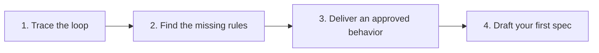

# Workshop plan: Spec-Driven Delivery with OpenSpec, Gherkin and GitHub Copilot

## Overview

- **Capability at the end:** Take one business intent through the spec-driven loop. Question it, write it as an
  OpenSpec change with Given/When/Then scenarios, deliver it with GitHub Copilot against automated evidence,
  keep the living specification current, and decide honestly whether your own next problem is ready to build.
- **Audience:** Mixed-role delivery teams (product owners, business analysts, testers, developers, architects)
  who use GitHub for everyday work but have not used specification-driven delivery. Only exercise 3 changes
  code, and Copilot does most of that work.
- **Delivery:** Instructor-led full day (480 minutes including lunch and two breaks), or self-paced in four
  sittings of about 35 to 75 minutes.
- **Environment:** Personal GitHub accounts (or a learning organization) with GitHub Codespaces. Each exercise
  opens a ready-to-use codespace with Node.js 22, the GitHub CLI, the pinned OpenSpec CLI and, in exercises 1 and 3,
  Cucumber.js already installed.

**Principle used throughout:** AI drafts; humans decide. Every exercise uses fictional organizations
(Contoso, Fabrikam, Northwind, Proseware) and synthetic data only.

## Prerequisites and pre-work

- A GitHub account that can create public repositories and use GitHub Codespaces (personal accounts include a
  monthly free Codespaces allowance).
- Access to GitHub Copilot Chat in VS Code. Copilot Free works, but its monthly allowance is limited and the full
  day uses many prompts; every exercise explains how to continue without Copilot except the implementation in
  exercise 3.
- Comfort with branches, commits and pull requests. Pre-work for anyone new to them:
  [Introduction to GitHub](https://github.com/skills/introduction-to-github) (about 1 hour).

## Exercise sequence

| # | Exercise | Objective (one new skill) | Depends on | Planned time |
| --- | --- | --- | --- | --- |
| 1 | Trace the Loop from Intent to Evidence (`spec-driven-trace-the-loop`) | Trace an approved behavior from intent to requirement, scenario, code and passing evidence, and name what the evidence does not prove | none | 35 min |
| 2 | Find the Missing Rules Before You Build (`spec-driven-find-missing-rules`) | Turn a thin epic into a strictly valid OpenSpec change whose requirements close real delivery gaps | 1 | 45 min |
| 3 | Deliver an Approved Behavior with Copilot (`spec-driven-deliver-a-behavior`) | Deliver one approved OpenSpec change with Copilot through human gates, traceable evidence, CI and archive | 1, 2 | 75 min |
| 4 | Draft Your First Spec (`spec-driven-first-spec`) | Independently draft a candidate OpenSpec change with three or more scenarios and make a reasoned Ready to build decision | 1, 2, 3 | 60 min |

## Agenda

| Time | Block | Facilitator does | Learners do | Checkpoint |
| --- | --- | --- | --- | --- |
| 0:00 | Welcome and method (20) | Frame the loop and the four human gates; verify access | Copy exercise 1, open its codespace | Everyone sees the exercise issue and a running codespace |
| 0:20 | Exercise 1 (40) | Circulate; prompt "what does this evidence not prove?" | Trace two scenarios and record a gap | Mona posts the review |
| 1:00 | Debrief 1 (10) | Ask for unproven parts and unconfirmed capabilities | Share one gap | |
| 1:10 | Exercise 2 (50) | Remind: write your own questions before asking Copilot | Question the epic, draft and validate an OpenSpec change | Strict validation passes |
| 2:00 | Break (15) | | | |
| 2:15 | Debrief 2 (15) | Compare learner gap coverage with the 2025 gap log | Share which gaps they caught | |
| 2:30 | Exercise 3, steps 1 to 2 (60) | Watch for learners editing tests; reinforce the plan gate | Plan, then implement with Copilot | Step 2 checks pass |
| 3:30 | Lunch (60) | | | |
| 4:30 | Exercise 3, steps 3 to 5 (55) | Pair learners as reviewers for each other's pull requests | Pull request with evidence, CI, archive, merge | Mona posts the review |
| 5:25 | Debrief 3 (10) | Discuss what green CI does not prove | | |
| 5:35 | Break (15) | | | |
| 5:50 | Exercise 4, capstone (70) | Pair learners; at minute 50, swap pairs to pressure-test Ready to build | Draft their first spec | Pull request opened |
| 7:00 | Readouts (40) | Time-box two minutes per pair | Share gate decision, blocker and measure | |
| 7:40 | Wrap-up (20) | Recap capabilities, survey, next-week handoff | Reflection, survey | |

Total: 480 minutes, including lunch and two breaks.

## Spacing and retrieval plan

- Exercise 2 reuses exercise 1's scenario-to-requirement link without full instructions (learners name the
  requirement ID each scenario belongs to).
- Exercise 3 reuses exercise 2's strict validation and exercise 1's evidence-boundary question, this time about
  the learner's own pull request.
- Exercise 4 reuses all three with goal-only instructions: OpenSpec structure, scenarios, the readiness questions
  and the gate decision.
- Follow-up a week later: each pair brings its exercise 4 pull request to its team and records who confirmed the
  first open assumption.

## Environment checklist

See [preflight-checklist.md](preflight-checklist.md). Owner: workshop lead.

## Facilitation

- Lead: workshop lead. Helpers: one per 10 to 12 learners. Help channel: the event chat.
- Stuck-learner protocol and troubleshooting: see [facilitator-guide.md](facilitator-guide.md).

## Evaluation

| Level | Instrument | Owner |
| --- | --- | --- |
| Reaction | Three-question survey at wrap-up (usefulness, confidence, what to change) | Workshop lead |
| Learning | Completed exercise reviews plus the exercise 4 pull request (structure validated by Mona, content discussed in readouts) | Facilitators |
| Behavior | Two to four weeks later: did the team open a spec-first change with scenarios and record a Ready to build decision? | Team leads |

## Risks and mitigations

| Risk | Mitigation |
| --- | --- |
| Codespaces quota or policy blocks a learner | Pair them with a neighbor; the exercises also run locally with Node.js 22 and `npm ci` |
| Copilot output varies between learners | No check depends on Copilot's wording; checks grade files, validation and tests |
| Learners treat self-merge as approval | Exercise 3 states that a solo learner cannot independently approve their own pull request; facilitators pair learners as reviewers |
| Organization Actions allowlist blocks the toolkit | Run the preflight with a participant-like account; exercise 3 uses `wait-for-workflow`, which is not on the EMU strict allowlist at `v0.9.3` |
| Real data pasted into prompts | Every exercise repeats the synthetic-data rule; exercise 4 forbids pasting real work items |
